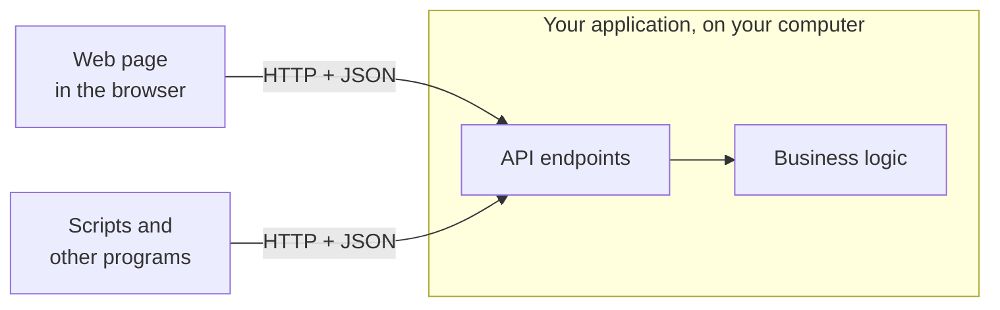
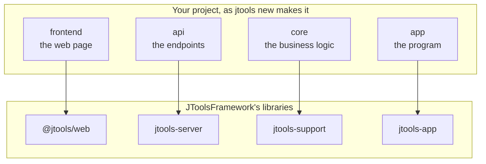

# JToolsFramework

**JToolsFramework helps Java developers build a local web application**: a program that runs on the user's
computer, with a Java server holding all the business logic and a web page in the browser as its user interface. The
server's endpoints form an HTTP API — JSON in, JSON out — so scripts and other programs can use the application just as
its page does ([A page and an API](#a-page-and-an-api)).

You write the business logic, the API's endpoints and the page; JToolsFramework provides the rest.

## What it is

JToolsFramework is four things:

- **a small framework** — the libraries a program's code calls: the server, the endpoints, the command line, the
  settings, the log, the stop (`jtools-app`; the JDK and nothing else);
- **its build conventions** — the parent pom a project inherits: Java 25, the tests, the program's one jar, the
  distributions with a runtime jlink trims (`jtools-parent`);
- **a development environment** — the scripts a project carries (setup, build, run, package…), its tools downloaded
  into the project, never taken from the machine (`jtools-devkit`);
- **a project template** — the way a new project begins (`jtools new`).

### The framework

A few Java libraries your program calls. You write the business and its endpoints; the libraries do the rest: the web
server, the command line (`--port`, `--help`…), the settings, the log, opening the browser, and stopping the program
once its page is closed. They need nothing but the JDK. [The libraries](#the-libraries) below says what each gives.

### The build conventions

One parent pom, `jtools-parent`. Your project names it and sets five properties — its id, name, main class, port and
Windows version — and the build follows: Java 25, the tests, the Angular page built and packed into the program's
single jar, and with `-Pdist` an archive for Linux, macOS and Windows, each with a Java runtime trimmed to what the
program needs. Nothing to install to run it.

### The development environment

The scripts every project carries — `setup`, `build`, `ci`, `run`, `stop`, `package` and `jtools` — in `.sh` for Linux
and in `.bat` for Windows, which needs no Git Bash. `setup` downloads the project's own JDK, Maven and Node.js into its
`external/` folder, the ones for the computer it runs on, at the versions its `externals.conf` names: nothing is taken
from your machine, so the project builds the same everywhere. `scripts/jtools sync` keeps the scripts up to date with
the framework.

### The project template

`jtools new Bookshelf` makes a complete project that runs at once: the business (`core`), its API (`api`), the page
(`frontend`) and the program (`app`), with a first endpoint, its tests, a git repository and a first build. You start
from working code, not from a blank folder.

Apache License 2.0. Version 1.3.1; on Maven Central once published (until then, the delivery's `install.sh` — the
[quick start](#quick-start-a-new-project-step-by-step) — puts it in `~/.m2`). [doc/CONCEPTS.md](doc/CONCEPTS.md) says
the idea behind it in one page.

## Quick start: a new project, step by step

**0. What you need**: Linux, with `bash`, `curl`, `unzip`, `tar` and `git`; or Windows 10 or later, with
[Git for Windows](https://git-scm.com/download/win) for the project's repository. Nothing else — no Java, Maven nor
Node.js to install: a project downloads its own into its `external/` folder the first time (about 450 MB).

**1. Download the delivery** — one archive, the framework and its installer, from the
[release](https://github.com/j4ckk0/JToolsFramework/releases/tag/v1.3.1):

```bash
curl -fsSLO https://github.com/j4ckk0/JToolsFramework/releases/download/v1.3.1/jtools-1.3.1.tar.gz
tar xzf jtools-1.3.1.tar.gz
```

**2. Install, and make your project** — `install.sh` asks the project's name and the folder its files go in:

```bash
jtools-1.3.1/install.sh                                   # asks; or says it all at once:
jtools-1.3.1/install.sh Bookshelf --dir ~/work/bookshelf
```

**On Windows**, the same with `.bat` scripts — no Git Bash, no PowerShell script: plain `.bat` files, with the `curl`
and `tar` Windows 10 comes with. Download `jtools-1.3.1.zip` from the
[release](https://github.com/j4ckk0/JToolsFramework/releases/tag/v1.3.1), extract it (right-click ▸ *Extract All*),
and double-click `jtools-1.3.1\install.bat`: it asks the project's name and folder, and offers to put `jtools` on
your `PATH`. From a command prompt, `jtools-1.3.1\install.bat Bookshelf --dir C:\work\bookshelf` says them at once.
Each command below has its `.bat` twin: `scripts\run.bat`, `scripts\build.bat`, `scripts\package.bat`,
`scripts\jtools sync`.

It puts the framework into your local Maven repository (`~/.m2`) and `jtools` into `~/.local/bin`, then makes the
project: its files in that folder, its development environment — a JDK, Maven and Node.js of its own, in its
`external/` — downloaded, a git repository, a first build. A minute or two the first time; later projects,
`jtools new <Name> --dir <folder>`.

```
bookshelf/
├── core/       the business: Bookshelf.java, pure Java — every rule, every computation, every state
├── api/        its HTTP face: BookshelfApi.java — each endpoint asks core and turns its answer into JSON
├── frontend/   the Angular page: a view, it decides nothing — api.service.ts is its one door to the server
├── app/        the program: Launcher.java, a WebApp serving the API; its one jar and its distributions
└── scripts/    setup, build, ci, run, stop, package — and jtools
```

**3. Run it**: `cd ~/work/bookshelf && scripts/run.sh` — the page opens in your browser; close it, and 15 seconds later the
program stops (`--keep-alive` keeps it serving).

**4. Add a feature**, one layer at a time: a method in `core` decides, an endpoint in `api` translates it to JSON, a method
in `api.service.ts` and a view in `frontend` show it. `scripts/run.sh` rebuilds when a source is newer.

**5. Test it**: `scripts/build.sh` — every Java test and the page's.

**6. Ship it**: `scripts/package.sh` — `releases/bookshelf-0.1.0-linux.tar.gz`, `-macos.tar.gz` and `-windows.zip`,
each with its launchers and a trimmed Java runtime: unpack, run, nothing to install.

**7. Keep it up to date**: `scripts/jtools sync` refreshes the scripts at the framework version `jtools.conf` names.

The internet is needed the first time: the project's tools and the libraries its build uses (Maven plugins, npm
packages) are downloaded; the framework itself is in the archive. To change the framework too, clone it instead:
`git clone`, then `scripts/setup.sh && scripts/install.sh` in the clone, and its `devkit/scripts/jtools` is your
`jtools`.

[doc/GETTING-STARTED.md](doc/GETTING-STARTED.md) is the same walk in full — what to type, what you should see, the code of
step 4, what to do when something goes wrong — in fifteen minutes.

## The libraries

| Library | What a program gets | Start from |
|---|---|---|
| `jtools-app` | the program around the server: the command line (`--port`, `--no-browser`, `--lang`, `--help`…), the `.ini`, the Settings menu, the log, the browser opened, the stop once the last page is closed; the endpoints `/api/settings`, `/api/about`, `/api/quit` | `WebApp` |
| `jtools-server` | the HTTP server: the program's endpoints (a `Map` or a `List` answered as JSON, a refusal as `{"error"}`), the page's files, the pages' presence, the Host and Origin checks | `WebServer`, `Exchange` |
| `jtools-support` | JSON, the texts in each language (`Accept-Language` honoured), the installation's folder and version | `Json`, `Catalogue` |
| `jtools-desktop` | native open, save and folder dialogs, for a program that wants them | `FileDialogs` |
| `@jtools/web` | the Angular page's side: its presence, the API's refusals as sentences | `provideJTools()` |

A whole program, its page aside:

```java
public static void main(String[] args) {
    WebApp.named("Hello").defaultPort(8089).pageRoot("web")
          .endpoints(server -> server.get("/api/hello", ex -> Map.of("message", "Hello, " + ex.query("name", "world"))))
          .launch(args);
}
```

[examples/hello](examples/hello) is that program with its page in plain JavaScript; [doc/LIBRARIES.md](doc/LIBRARIES.md)
says what each library gives in full.

### Architecture

**How the application runs.** The web page and any other program talk to the same API endpoints; only the business
logic decides.



**What a project is built from.** Each of its four parts stands on one of the framework's libraries.



- **core** holds the business logic: pure Java, testable without a server or a page.
- **api** translates: each endpoint asks `core`, and turns the answer into JSON.
- **frontend** is the web page: it shows what the API answers, and decides nothing.
- **app** is the program: `WebApp` (from `jtools-app`) puts it all together; the build makes it one jar.

The program's module depends on `jtools-app`, which brings `jtools-server` and `jtools-support`; `core` and `api` each
name the one library they use. `jtools-desktop`, for native file dialogs, is optional.

### A page and an API

Every endpoint a program declares — `server.get("/api/books", …)`, `server.post(…)` — is plain HTTP and JSON. Its page
is one client of it; anything that speaks HTTP is another:

```bash
curl 'http://127.0.0.1:8089/api/hello?name=script'   # {"message":"Hello, script!"}, from examples/hello
```

- **Without a page**: `--no-browser` starts the program without opening one, and it keeps serving until it is told to
  stop (`scripts/stop.sh`, `POST /api/quit`, Ctrl+C). The framework's own endpoints come with it: `/api/about`,
  `/api/settings`, `/api/quit`.
- **Another protocol beside the JSON**: `server.handle("/mcp", handler)` mounts a plain JDK handler — an assistant's
  tool endpoint, say — behind the same checks.
- **Errors a client can read**: a refusal is `{"error": reason}` with its status (400, 404, 405, 409…); the
  framework's own say their reason in the language the request's `Accept-Language` asks for.
- **This computer's, by default**: the server listens on `127.0.0.1`. It refuses a request naming another host (DNS
  rebinding) and a request that changes state from another site's page (403); scripts and programs, which send no
  `Origin`, are answered. `--host 0.0.0.0` serves the network, **with no authentication**: only on a network you trust.

## What this repository contains

| Folder | What | Published as |
|---|---|---|
| [`libraries/`](libraries) | `support`, `server`, `app`, `desktop`: the Java libraries; `web`: `@jtools/web`, for an Angular page | `jtools-support`, `-server`, `-app`, `-desktop`, `-web` |
| [`conventions/`](conventions) | `parent`: the build; `bom`: the versions alone; `dist`: the distributions' build (jdeps, jlink, the archives) and launchers | `jtools-parent`, `jtools-bom`, `jtools-dist` |
| [`devkit/`](devkit) | what a project carries: its scripts, its pre-push hook, `.gitattributes`, the default `externals.conf`; `scripts/jtools` | `jtools-devkit`, with the starter |
| [`starter/`](starter) | the template and `new-project.sh`, which `jtools new` runs | in `jtools-devkit` |
| [`delivery/`](delivery) | the delivery's installers — `install.sh` for Linux, `install.bat` for Windows — and README; `scripts/delivery.sh` builds the archives a release carries | `jtools-<version>.tar.gz` and `.zip`, on GitHub's releases |
| [`examples/`](examples) | `hello`, `todo`, `greeter`: three very small programs, each a step further | never: built and tested with the rest |
| [`doc/`](doc) | [GETTING-STARTED](doc/GETTING-STARTED.md), [CONCEPTS](doc/CONCEPTS.md), [LIBRARIES](doc/LIBRARIES.md), [CONVENTIONS](doc/CONVENTIONS.md), [DEVKIT](doc/DEVKIT.md), [ADOPTING](doc/ADOPTING.md) (moving an existing program onto it), [design/](doc/design) (why it is as it is) | — |
| `scripts/` | the framework's own — `install`, `check-versions`, `ci.local`, `delivery` — and the devkit's, which the framework carries like any project | — |

**Developing the framework itself**:

```bash
scripts/setup.sh       # the externals: JDK 25, Maven, Node.js, each platform's jmods (once)
scripts/install.sh     # versions agree, build, test, install into ~/.m2
scripts/ci.sh          # the same quietly, then: the framework's scripts equal the devkit's, and a project made by a lone
                       # scripts/jtools from the installed devkit passes its own CI
```

`git config core.hooksPath .githooks` runs `scripts/ci.sh` before every push. A project developed together with the
framework names the clone in its `jtools.conf` (`JTOOLS_HOME`): its `scripts/jtools` then takes the devkit from the
working tree. Publishing to Maven Central: [PUBLISHING.md](PUBLISHING.md).

## The dependencies to set

A project made by `jtools new` has all of this already. For one made by hand, or an existing program moving onto the
framework ([doc/ADOPTING.md](doc/ADOPTING.md)):

**The parent**, in the root pom — the build conventions, and the framework's versions:

```xml
<parent>
  <groupId>org.jtools.framework</groupId>
  <artifactId>jtools-parent</artifactId>
  <version>1.3.1</version>
  <relativePath/>
</parent>
<properties>
  <jtools.app.id>bookshelf</jtools.app.id>                          <!-- its jar, .ini, launchers, releases -->
  <jtools.app.name>Bookshelf</jtools.app.name>                      <!-- as people read it; its .exe -->
  <jtools.app.mainClass>org.jtools.bookshelf.app.Launcher</jtools.app.mainClass>
  <jtools.app.port>8090</jtools.app.port>                           <!-- what its .ini says -->
  <jtools.app.windowsVersion>0.1.0.0</jtools.app.windowsVersion>    <!-- the version in four parts -->
</properties>
```

**The libraries**, in the program's module — with no version, the parent says it — and `jtools.app.skip` set to
`false` there, which makes that module's jar the program's:

```xml
<properties>
  <jtools.app.skip>false</jtools.app.skip>
</properties>
<dependencies>
  <dependency>
    <groupId>org.jtools.framework</groupId>
    <artifactId>jtools-app</artifactId>          <!-- brings jtools-server and jtools-support -->
  </dependency>
  <dependency>
    <groupId>org.jtools.framework</groupId>
    <artifactId>jtools-desktop</artifactId>      <!-- only for native file dialogs -->
  </dependency>
</dependencies>
```

A business module that uses `Json` or the texts depends on `jtools-support` alone; an API module, on `jtools-server`.

**With a parent of its own, or Gradle**: import `jtools-bom` for the versions — the libraries then, not the
conventions (the one jar and the distributions are jtools-parent's):

```kotlin
dependencies {
    implementation(platform("org.jtools.framework:jtools-bom:1.3.1"))
    implementation("org.jtools.framework:jtools-app")
}
```

**The page**: nothing to declare. In a module holding an `angular.json`, jtools-parent unpacks `@jtools/web` into
`target/jtools-web`, and the page's `tsconfig.json` maps it: `"paths": { "@jtools/web": ["./target/jtools-web/index.ts"] }`.

**The tools** — JDK, Maven, Node.js — are named in the project's `externals.conf`, with their versions, and
`scripts/setup.sh` downloads them into `external/`: none is installed on the machine
([doc/DEVKIT.md](doc/DEVKIT.md)).
