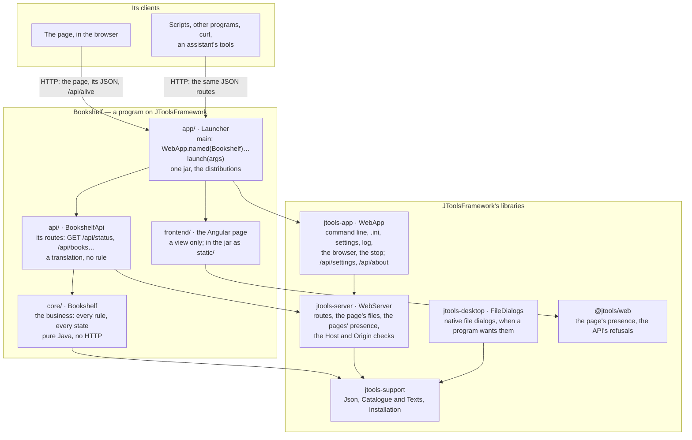

# JToolsFramework

## What it is

For a **local web application in Java**: a server on your computer holds the whole business, a page in the browser is
its view, and the program stops once its last page is closed — like any program whose window you close. It ships as
self-contained archives for Linux, macOS and Windows, a Java runtime inside.

The server is more than the page's back end: **its routes are an HTTP API of their own**, JSON in and out, which
scripts, other programs and tools call as the page does. The same program runs with its page, or without any, as a
service that keeps serving (`--no-browser`) — [below](#a-page-and-an-api).

JToolsFramework is four things:

- **a small framework** — the libraries a program's code calls: the server, the routes, the command line, the
  settings, the log, the stop (`jtools-app`; the JDK and nothing else);
- **its build conventions** — the parent pom a project inherits: Java 25, the tests, the program's one jar, the
  distributions with a runtime jlink trims (`jtools-parent`);
- **a development environment** — the scripts a project carries (setup, build, run, package…), its tools downloaded
  into the project, never taken from the machine (`jtools-devkit`);
- **a project template** — the way a new project begins (`jtools new`).

Apache License 2.0. Version 1.2.0; on Maven Central once published (until then, a clone's `scripts/install.sh` puts it
in `~/.m2`). [doc/CONCEPTS.md](doc/CONCEPTS.md) says the idea behind it in one page.

## Quick start: a new project, step by step

**0. What you need**: Linux, macOS, or Windows with Git Bash; `bash`, `curl`, `unzip`, `tar` and `git`. Nothing else —
no Java, Maven nor Node.js to install: a project downloads its own into its `external/` folder the first time (about
450 MB).

**1. Download the delivery** — one archive, the framework and its installer, from the
[release](https://github.com/j4ckk0/JToolsFramework/releases/tag/v1.2.0):

```bash
curl -fsSLO https://github.com/j4ckk0/JToolsFramework/releases/download/v1.2.0/jtools-1.2.0.tar.gz
tar xzf jtools-1.2.0.tar.gz
```

**2. Install, and make your project** — `install.sh` asks the project's name and the folder its files go in:

```bash
jtools-1.2.0/install.sh                                   # asks; or says it all at once:
jtools-1.2.0/install.sh Bookshelf --dir ~/work/bookshelf
```

It puts the framework into your local Maven repository (`~/.m2`) and `jtools` into `~/.local/bin`, then makes the
project: its files in that folder, its development environment — a JDK, Maven and Node.js of its own, in its
`external/` — downloaded, a git repository, a first build. A minute or two the first time; later projects,
`jtools new <Name> --dir <folder>`.

```
bookshelf/
├── core/       the business: Bookshelf.java, pure Java — every rule, every computation, every state
├── api/        its HTTP face: BookshelfApi.java — each route asks core and turns its answer into JSON
├── frontend/   the Angular page: a view, it decides nothing — api.service.ts is its one door to the server
├── app/        the program: Launcher.java, a WebApp serving the API; its one jar and its distributions
└── scripts/    setup, build, ci, run, stop, package — and jtools
```

**3. Run it**: `cd ~/work/bookshelf && scripts/run.sh` — the page opens in your browser; close it, and 15 seconds later the
program stops (`--keep-alive` keeps it serving).

**4. Add a feature**, one layer at a time: a method in `core` decides, a route in `api` translates it to JSON, a method
in `api.service.ts` and a view in `frontend` show it. `scripts/run.sh` rebuilds when a source is newer.

**5. Test it**: `scripts/build.sh` — every Java test and the page's.

**6. Ship it**: `scripts/package.sh` — `releases/bookshelf-0.1.0-linux.tar.gz`, `-macos.tar.gz` and `-windows.zip`,
each with its launchers and a trimmed Java runtime: unpack, run, nothing to install.

**7. Keep it up to date**: `scripts/jtools sync` refreshes the scripts at the framework version `jtools.conf` names.

The internet is needed the first time: the project's tools and the libraries its build uses (Maven plugins, npm
packages) are downloaded; the framework itself is in the archive. To change the framework too, clone it instead:
`git clone`, then `scripts/setup.sh && scripts/install.sh` in the clone, and its `devkit/scripts/jtools` is your
`jtools`.

[doc/GETTING-STARTED.md](doc/GETTING-STARTED.md) is the same walk in full — what to type, what you should see, the code of
step 4, what to do when something goes wrong — in fifteen minutes.

## The libraries

| Library | What a program gets | Start from |
|---|---|---|
| `jtools-app` | the program around the server: the command line (`--port`, `--no-browser`, `--lang`, `--help`…), the `.ini`, the Settings menu, the log, the browser opened, the stop once the last page is closed; the routes `/api/settings`, `/api/about`, `/api/quit` | `WebApp` |
| `jtools-server` | the HTTP server: the program's routes (a `Map` or a `List` answered as JSON, a refusal as `{"error"}`), the page's files, the pages' presence, the Host and Origin checks | `WebServer`, `Exchange` |
| `jtools-support` | JSON, the texts in each language (`Accept-Language` honoured), the installation's folder and version | `Json`, `Catalogue` |
| `jtools-desktop` | native open, save and folder dialogs, for a program that wants them | `FileDialogs` |
| `@jtools/web` | the Angular page's side: its presence, the API's refusals as sentences | `provideJTools()` |

A whole program, its page aside:

```java
public static void main(String[] args) {
    WebApp.named("Hello").defaultPort(8089).pageRoot("web")
          .routes(server -> server.get("/api/hello", ex -> Map.of("message", "Hello, " + ex.query("name", "world"))))
          .launch(args);
}
```

[examples/hello](examples/hello) is that program with its page in plain JavaScript; [doc/LIBRARIES.md](doc/LIBRARIES.md)
says what each library gives in full.

### Architecture

A program on the framework — `Bookshelf`, as `jtools new` makes it — and the libraries it stands on. Each arrow is a
dependency, but the two at the top, which are requests over HTTP.



- **The business is `core`'s alone**: pure Java, testable and usable without a server or a page.
- **`api` translates**: each route asks `core` and turns its answer into JSON; a refusal is `{"error": reason}`.
- **The page decides nothing**: it shows what the API answers. Any other client sees exactly the same API.
- **`app` is the program**: `WebApp` puts the server, the API, the page and the framework's own routes together, and
  the build makes them one jar and its distributions.

### A page and an API

Every route a program declares — `server.get("/api/books", …)`, `server.post(…)` — is plain HTTP and JSON. Its page is
one client of it; anything that speaks HTTP is another:

```bash
curl 'http://127.0.0.1:8089/api/hello?name=script'   # {"message":"Hello, script!"}, from examples/hello
```

- **Without a page**: `--no-browser` starts the program without opening one, and it keeps serving until it is told to
  stop (`scripts/stop.sh`, `POST /api/quit`, Ctrl+C). The framework's own routes come with it: `/api/about`,
  `/api/settings`, `/api/quit`.
- **Another protocol beside the JSON**: `server.handle("/mcp", handler)` mounts a plain JDK handler — an assistant's
  tool endpoint, say — behind the same checks.
- **Errors a client can read**: a refusal is `{"error": reason}` with its status (400, 404, 405, 409…); the
  framework's own say their reason in the language the request's `Accept-Language` asks for.
- **This computer's, by default**: the server listens on `127.0.0.1`. It refuses a request naming another host (DNS
  rebinding) and a request that changes state from another site's page (403); scripts and programs, which send no
  `Origin`, are answered. `--host 0.0.0.0` serves the network, **with no authentication**: only on a network you trust.

## What this repository contains

| Folder | What | Published as |
|---|---|---|
| [`libraries/`](libraries) | `support`, `server`, `app`, `desktop`: the Java libraries; `web`: `@jtools/web`, for an Angular page | `jtools-support`, `-server`, `-app`, `-desktop`, `-web` |
| [`conventions/`](conventions) | `parent`: the build; `bom`: the versions alone; `dist`: the distributions' build (jdeps, jlink, the archives) and launchers | `jtools-parent`, `jtools-bom`, `jtools-dist` |
| [`devkit/`](devkit) | what a project carries: its scripts, its pre-push hook, `.gitattributes`, the default `externals.conf`; `scripts/jtools` | `jtools-devkit`, with the starter |
| [`starter/`](starter) | the template and `new-project.sh`, which `jtools new` runs | in `jtools-devkit` |
| [`delivery/`](delivery) | the delivery's installer and README; `scripts/delivery.sh` builds the archive a release carries | `jtools-<version>.tar.gz`, on GitHub's releases |
| [`examples/`](examples) | `hello`, `todo`, `greeter`: three very small programs, each a step further | never: built and tested with the rest |
| [`doc/`](doc) | [GETTING-STARTED](doc/GETTING-STARTED.md), [CONCEPTS](doc/CONCEPTS.md), [LIBRARIES](doc/LIBRARIES.md), [CONVENTIONS](doc/CONVENTIONS.md), [DEVKIT](doc/DEVKIT.md), [ADOPTING](doc/ADOPTING.md) (moving an existing program onto it), [design/](doc/design) (why it is as it is) | — |
| `scripts/` | the framework's own — `install`, `check-versions`, `ci.local`, `delivery` — and the devkit's, which the framework carries like any project | — |

**Developing the framework itself**:

```bash
scripts/setup.sh       # the externals: JDK 25, Maven, Node.js, each platform's jmods (once)
scripts/install.sh     # versions agree, build, test, install into ~/.m2
scripts/ci.sh          # the same quietly, then: the framework's scripts equal the devkit's, and a project made by a lone
                       # scripts/jtools from the installed devkit passes its own CI
```

`git config core.hooksPath .githooks` runs `scripts/ci.sh` before every push. A project developed together with the
framework names the clone in its `jtools.conf` (`JTOOLS_HOME`): its `scripts/jtools` then takes the devkit from the
working tree. Publishing to Maven Central: [PUBLISHING.md](PUBLISHING.md).

## The dependencies to set

A project made by `jtools new` has all of this already. For one made by hand, or an existing program moving onto the
framework ([doc/ADOPTING.md](doc/ADOPTING.md)):

**The parent**, in the root pom — the build conventions, and the framework's versions:

```xml
<parent>
  <groupId>org.jtools.framework</groupId>
  <artifactId>jtools-parent</artifactId>
  <version>1.2.0</version>
  <relativePath/>
</parent>
<properties>
  <jtools.app.id>bookshelf</jtools.app.id>                          <!-- its jar, .ini, launchers, releases -->
  <jtools.app.name>Bookshelf</jtools.app.name>                      <!-- as people read it; its .exe -->
  <jtools.app.mainClass>org.jtools.bookshelf.app.Launcher</jtools.app.mainClass>
  <jtools.app.port>8090</jtools.app.port>                           <!-- what its .ini says -->
  <jtools.app.windowsVersion>0.1.0.0</jtools.app.windowsVersion>    <!-- the version in four parts -->
</properties>
```

**The libraries**, in the program's module — with no version, the parent says it — and `jtools.app.skip` set to
`false` there, which makes that module's jar the program's:

```xml
<properties>
  <jtools.app.skip>false</jtools.app.skip>
</properties>
<dependencies>
  <dependency>
    <groupId>org.jtools.framework</groupId>
    <artifactId>jtools-app</artifactId>          <!-- brings jtools-server and jtools-support -->
  </dependency>
  <dependency>
    <groupId>org.jtools.framework</groupId>
    <artifactId>jtools-desktop</artifactId>      <!-- only for native file dialogs -->
  </dependency>
</dependencies>
```

A business module that uses `Json` or the texts depends on `jtools-support` alone; an API module, on `jtools-server`.

**With a parent of its own, or Gradle**: import `jtools-bom` for the versions — the libraries then, not the
conventions (the one jar and the distributions are jtools-parent's):

```kotlin
dependencies {
    implementation(platform("org.jtools.framework:jtools-bom:1.2.0"))
    implementation("org.jtools.framework:jtools-app")
}
```

**The page**: nothing to declare. In a module holding an `angular.json`, jtools-parent unpacks `@jtools/web` into
`target/jtools-web`, and the page's `tsconfig.json` maps it: `"paths": { "@jtools/web": ["./target/jtools-web/index.ts"] }`.

**The tools** — JDK, Maven, Node.js — are named in the project's `externals.conf`, with their versions, and
`scripts/setup.sh` downloads them into `external/`: none is installed on the machine
([doc/DEVKIT.md](doc/DEVKIT.md)).
