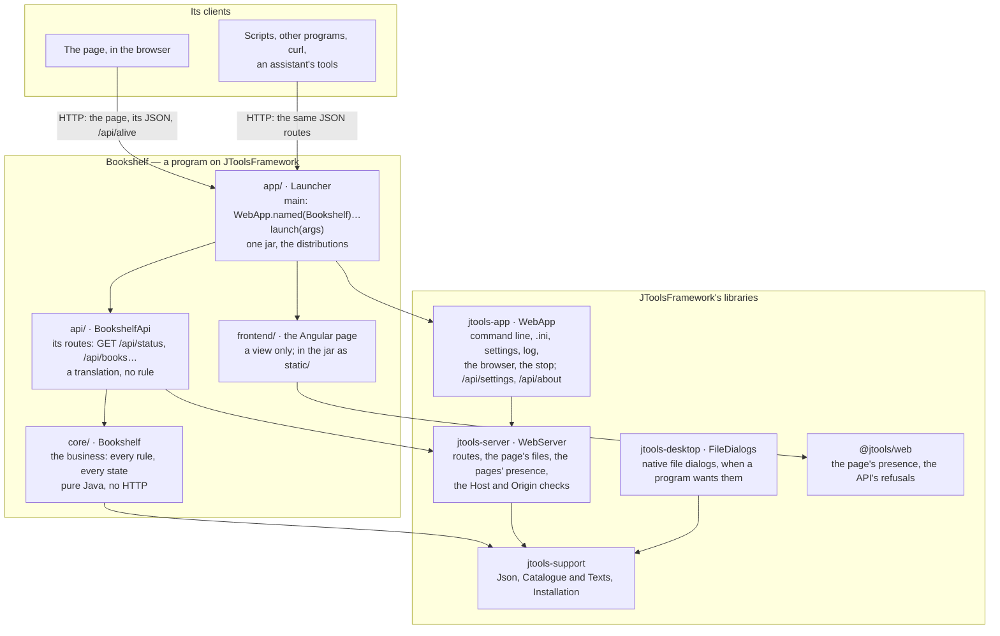

# JToolsFramework

For a **local web application in Java**: a server on your computer holds the whole business, a page in the browser is
its view, and the program stops once its last page is closed — like any program whose window you close. It ships as
self-contained archives for Linux, macOS and Windows, a Java runtime inside.

The server is more than the page's back end: **its routes are an HTTP API of their own**, JSON in and out, which
scripts, other programs and tools call as the page does. The same program runs with its page, or without any, as a
service that keeps serving (`--no-browser`) — [below](#a-page-and-an-api).

JToolsFramework is four things, each with a door below:

- **a small framework** — the libraries a program's code calls: the server, the routes, the command line, the
  settings, the log, the stop (`jtools-app`, the JDK and nothing else);
- **its build conventions** — the parent pom a project inherits: Java 25, the tests, the program's one jar, the
  distributions with a runtime jlink trims (`jtools-parent`);
- **a development environment** — the scripts a project carries (setup, build, run, package…), its tools downloaded
  into the project, never taken from the machine (`jtools-devkit`);
- **a project template** — the way a new project begins (`jtools new`).

Apache License 2.0. Version 1.2.0; on Maven Central once published (until then, `scripts/install.sh` puts it in
`~/.m2`). [doc/CONCEPTS.md](doc/CONCEPTS.md) says the idea behind it in one page.

## Architecture

A program on the framework — here `Bookshelf`, as `jtools new Bookshelf` makes it — and the libraries it stands on.
Each arrow is a dependency, but the two at the top, which are requests over HTTP.



- **The business is `core`'s alone**: pure Java, testable and usable without a server or a page.
- **`api` translates**: each route asks `core` and turns its answer into JSON; a refusal is `{"error": reason}`.
- **The page decides nothing**: it shows what the API answers. Any other client sees exactly the same API.
- **`app` is the program**: `WebApp` puts the server, the API, the page and the framework's own routes together, and
  the build makes them one jar and its distributions.
- **The libraries need the JDK and nothing else.** A program depends on `jtools-app`, which brings `jtools-server`
  and `jtools-support`; `jtools-desktop` is optional, and `@jtools/web` is for an Angular page.

## A page and an API

Every route a program declares — `server.get("/api/books", …)`, `server.post(…)` — is plain HTTP and JSON. Its page is
one client of it; anything that speaks HTTP is another:

```bash
curl 'http://127.0.0.1:8089/api/hello?name=script'   # {"message":"Hello, script!"}, from examples/hello
```

- **Without a page**: `--no-browser` starts the program without opening one, and it keeps serving until it is told to
  stop (`scripts/stop.sh`, `POST /api/quit`, Ctrl+C). The framework's own routes come with it: `/api/about`,
  `/api/settings`, `/api/quit`.
- **Another protocol beside the JSON**: `server.handle("/mcp", handler)` mounts a plain JDK handler — an assistant's
  tool endpoint, say — behind the same checks.
- **Errors a client can read**: a refusal is `{"error": reason}` with its status (400, 404, 405, 409…); the
  framework's own say their reason in the language the request's `Accept-Language` asks for.
- **This computer's, by default**: the server listens on `127.0.0.1`. It refuses a request naming another host (DNS
  rebinding) and a request that changes state from another site's page (403); scripts and programs, which send no
  `Origin`, are answered. `--host 0.0.0.0` serves the network, **with no authentication**: only on a network you trust.

[doc/LIBRARIES.md](doc/LIBRARIES.md) says the routes' API in full.

## Start an app

```bash
jtools new Bookshelf            # ./Bookshelf: four modules, its scripts, a git repository, built
cd Bookshelf
scripts/run.sh                  # the page in the browser; close it, and the program stops
```

`jtools` is one script, the devkit's [`scripts/jtools`](devkit/scripts/jtools): download it, or take it from a clone of
this repository. [doc/GETTING-STARTED.md](doc/GETTING-STARTED.md) walks through the generated project — where the
business goes, a feature added from core to the page, tested, packaged — in fifteen minutes.

## Use the libraries

A program depends on **`jtools-app`**, which brings `jtools-server` and `jtools-support`:

```java
public static void main(String[] args) {
    WebApp.named("Hello").defaultPort(8089).pageRoot("web")
          .routes(server -> server.get("/api/hello", ex -> Map.of("message", "Hello, " + ex.query("name", "world"))))
          .launch(args);
}
```

That is a whole program: `--port`, `--help`, its `.ini`, the log, the Settings menu, Quit and the stop come with it.
[examples/hello](examples/hello) is that program with its page in plain JavaScript; [doc/LIBRARIES.md](doc/LIBRARIES.md)
says what each library gives — `jtools-desktop` for native file dialogs, `jtools-web` for an Angular page.

## Build, run and ship it

A project's root pom names **`jtools-parent`** as its parent and says five things of its program — `jtools.app.id`,
`name`, `mainClass`, `port`, `windowsVersion`:

```xml
<parent>
  <groupId>org.jtools.framework</groupId>
  <artifactId>jtools-parent</artifactId>
  <version>1.2.0</version>
  <relativePath/>
</parent>
```

The build then makes the program's one jar, and with `-Pdist` its distributions ([doc/CONVENTIONS.md](doc/CONVENTIONS.md));
a Gradle build takes `jtools-bom`'s versions instead. The project's scripts — `setup`, `build`, `ci`, `run`, `stop`,
`package`, in `.sh` and `.bat` — are the devkit's, kept up to date by `scripts/jtools sync` at the version
`jtools.conf` names ([doc/DEVKIT.md](doc/DEVKIT.md)).

## What is where

| Folder | What | Published as |
|---|---|---|
| [`libraries/`](libraries) | `support`, `server`, `app`, `desktop`: the Java libraries; `web`: `@jtools/web`, for an Angular page | `jtools-support`, `-server`, `-app`, `-desktop`, `-web` |
| [`conventions/`](conventions) | `parent`: the build; `bom`: the versions alone; `dist`: the distributions' build (jdeps, jlink, the archives) and launchers | `jtools-parent`, `jtools-bom`, `jtools-dist` |
| [`devkit/`](devkit) | what a project carries: its scripts, its pre-push hook, `.gitattributes`, the default `externals.conf`; `scripts/jtools` | `jtools-devkit`, with the starter |
| [`starter/`](starter) | the template and `new-project.sh`, which `jtools new` runs | in `jtools-devkit` |
| [`examples/`](examples) | `hello`, `todo`, `greeter`: three very small programs, each a step further | never: built and tested with the rest |
| [`doc/`](doc) | [GETTING-STARTED](doc/GETTING-STARTED.md), [CONCEPTS](doc/CONCEPTS.md), [LIBRARIES](doc/LIBRARIES.md), [CONVENTIONS](doc/CONVENTIONS.md), [DEVKIT](doc/DEVKIT.md), [ADOPTING](doc/ADOPTING.md) (moving an existing program onto it), [design/](doc/design) (why it is as it is) | — |
| `scripts/` | the framework's own — `install`, `check-versions`, `ci.local` — and the devkit's, which the framework carries like any project | — |

## Developing the framework

```bash
scripts/setup.sh       # the externals: JDK 25, Maven, Node.js, each platform's jmods (once)
scripts/install.sh     # versions agree, build, test, install into ~/.m2
scripts/ci.sh          # the same quietly, then: the framework's scripts equal the devkit's, and a project made by a lone
                       # scripts/jtools from the installed devkit passes its own CI
```

`git config core.hooksPath .githooks` runs `scripts/ci.sh` before every push. A project developed together with the
framework names the clone in its `jtools.conf` (`JTOOLS_HOME`): its `scripts/jtools` then takes the devkit from the
working tree. Publishing to Maven Central: [PUBLISHING.md](PUBLISHING.md).
